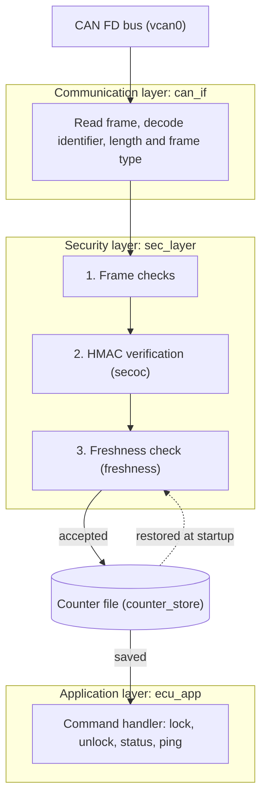
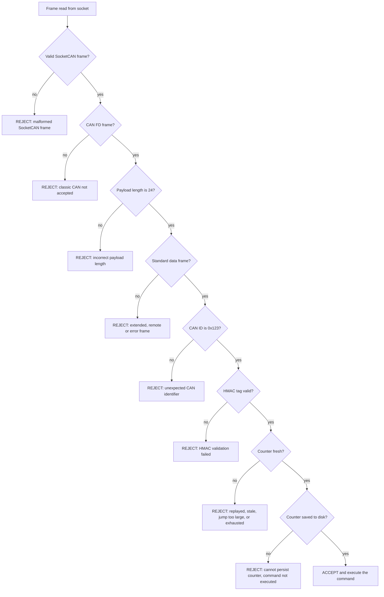
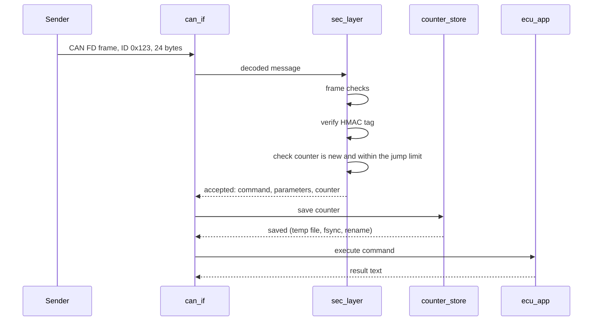

# Architecture

This document describes how the Secure ECU Simulator is structured, how a frame moves through it, and which module is responsible for each decision. For the security reasoning, see [THREAT-MODEL.md](THREAT-MODEL.md). For test evidence, see [TEST-REPORT.md](TEST-REPORT.md).

The design is AUTOSAR-inspired for learning purposes. It is not a complete AUTOSAR SecOC implementation and does not claim compliance with an AUTOSAR release.

## Layers

Each layer only knows about the layer next to it:

| Layer | Module | Responsibility | Knows nothing about |
|---|---|---|---|
| Communication | `can_if` | Opens the CAN socket, reads one frame, and reports its identifier, length, payload, and frame type | Keys, counters, commands |
| Security | `sec_layer` | Runs the validation pipeline and returns one result per frame | Sockets, ECU commands |
| Security | `secoc` | Builds and verifies the truncated HMAC-SHA-256 tag | Counters, sockets |
| Security | `freshness` | Decides whether a counter is new enough, and tracks the last accepted value | Keys, frames |
| Persistence | `counter_store` | Saves and restores the last accepted counter | What the counter means |
| Application | `ecu_app` | Executes a command on the simulated ECU state | Where the command came from |
| Program | `can_receiver` | Wires the layers together in a receive loop | |

Because `sec_layer` has no socket code, it can be tested with hand-built frames, and the fuzz harness can drive it millions of times without a CAN interface.

## Check order for every frame

The order is deliberate. Cheap structural checks come first, authentication comes before any state is touched, and the command runs last.

Three properties follow from this order:

1. **A forged frame never moves the counter.** Freshness is evaluated only after the HMAC passes.
2. **A rejected frame never changes state.** Every rejection path leaves the stored counter, the counter file, and the ECU state untouched.
3. **A command never runs before its counter is durable.** The counter is saved before the command executes. If the save fails, the command is not executed. A crash after the save can therefore lose a command, but it can never let the same frame be replayed after a restart.

## Secured message format

A 24-byte CAN FD payload on identifier `0x123`:

| Field | Offset | Size | Description |
|---|---:|---:|---|
| Command | 0 | 1 byte | Requested ECU operation |
| Parameters | 1 | 3 bytes | Command parameters (authenticated, unused by the current commands) |
| Freshness counter | 4 | 4 bytes | Unsigned, big-endian |
| Authentication tag | 8 | 16 bytes | Truncated HMAC-SHA-256 |

The tag covers the CAN identifier, the configured Data ID (`0x1234`), the command, the parameters, and the full freshness counter. The receiver compares tags in constant time.

## Accepted frame, step by step

In the code, the receive loop in `can_receiver.c` plays the role of the coordinator shown above.

## Freshness rules

After the HMAC check passes, a counter is accepted only if all of these hold:

- The last accepted counter is not `UINT32_MAX`.
- The new counter is strictly greater than the last accepted one.
- The forward jump is at most `FRESHNESS_MAX_JUMP` (default 1000). A limit of 0 disables the check.

A repeated counter is reported as a replay, a lower one as stale, and a larger-than-allowed jump as too large. Every rejection leaves the stored counter unchanged.

## Counter persistence

The last accepted counter lives in a file: `$SECURE_ECU_COUNTER_FILE`, or `~/.secure_ecu_counter` by default.

- **Missing file:** first start, the counter begins at 0.
- **Corrupt or unreadable file:** the receiver refuses to start. A silent reset would reopen the replay window.
- **Writes:** the value is written to a temporary file, flushed with `fsync`, and renamed over the real file, so a crash cannot leave a half-written counter.
- **Format:** one line, `v1 <counter> <bitwise complement in hex>`, which detects truncation and garbage.

## Build and test layout

| Program | Sources | Purpose |
|---|---|---|
| `can_receiver` | `can_receiver.c`, `can_if.c`, `sec_layer.c`, `secoc.c`, `freshness.c`, `counter_store.c`, `ecu_app.c` | The ECU |
| `secoc_sender` | `secoc_sender.c`, `secoc.c` | Sends valid and deliberately forged test frames |
| `test_*` | One per module | Unit tests (`make test`) |
| `fuzz_ecu` | `fuzz_ecu.c` plus every module except the socket layer | Fuzz and property tests under sanitizers (`make fuzz`) |
| `tests/live_test.sh` | Uses `can_receiver` and `secoc_sender` | Live integration test over `vcan0` (`make integration`) |
